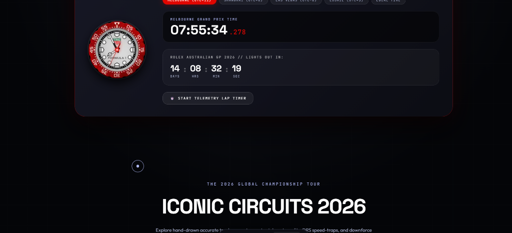
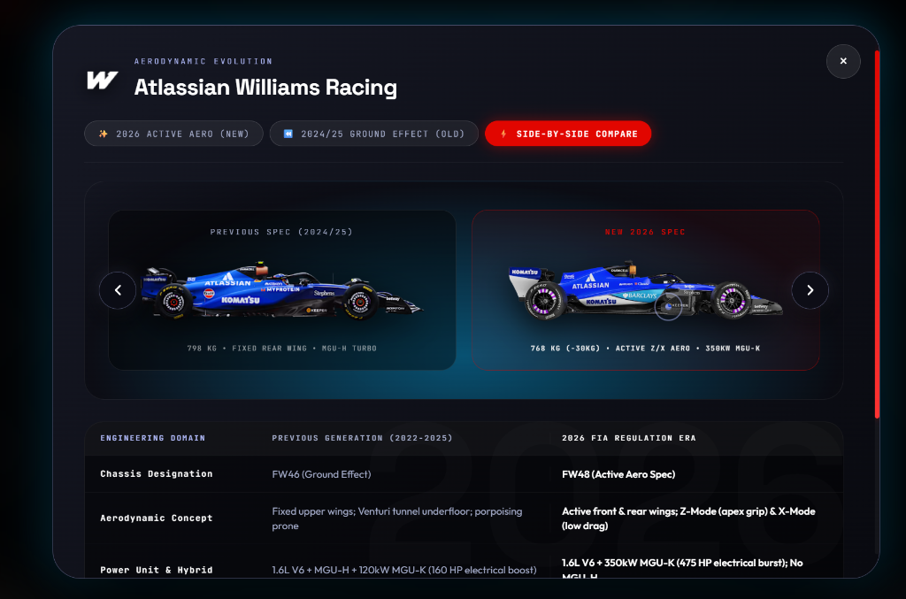
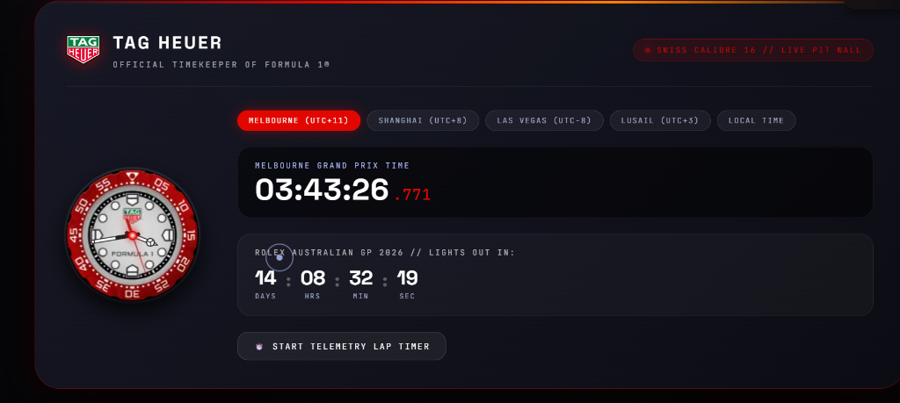
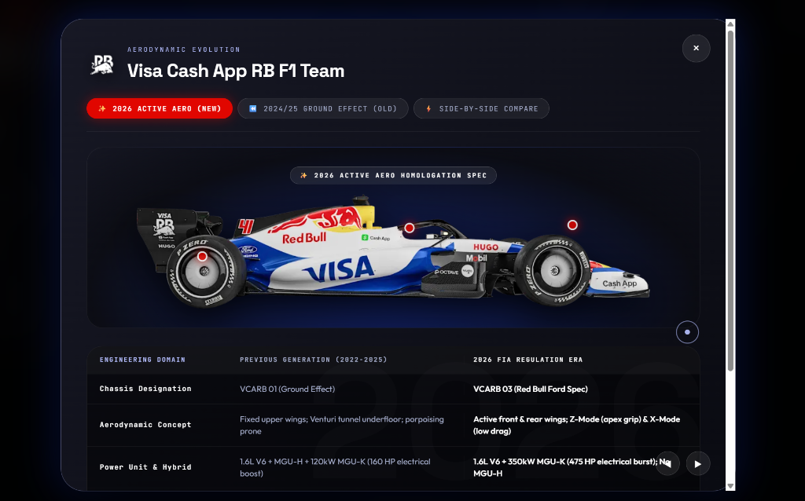
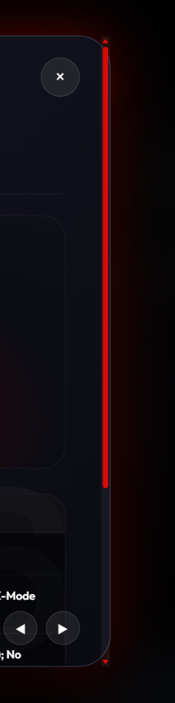
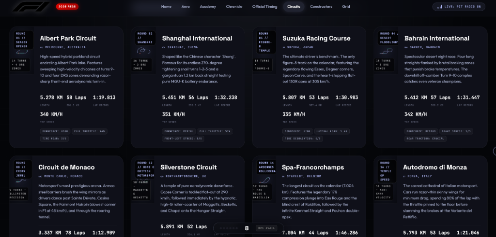
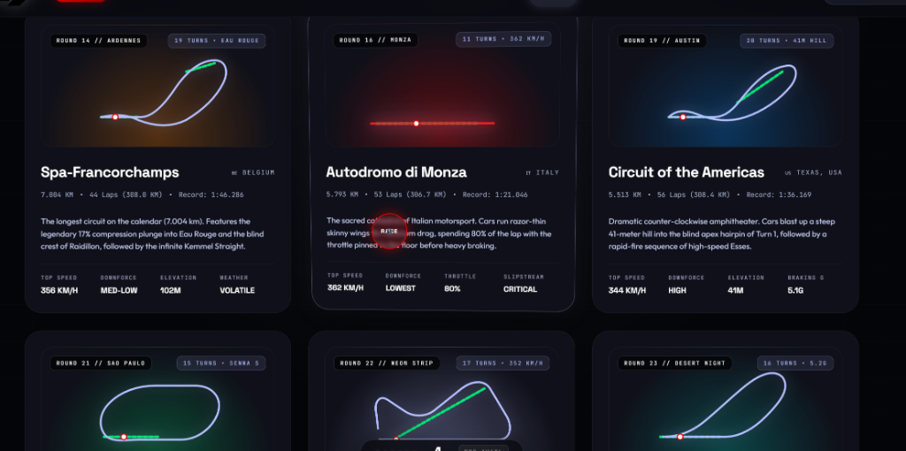

# 🏎️ F1 Reimagined // Next-Gen 2026 Interactive Paddock Experience

[](https://www.formula1.com)
[](https://gsap.com)
[](https://lenis.darkroom.engineering)
[](https://developer.mozilla.org)
[](LICENSE)

> **Welcome to the next generation of Formula 1.**  
> An ultra-high-performance, interactive digital paddock engineered to usher in the **2026 FIA Technical Regulations**—featuring 100% sustainable drop-in e-fuels, shape-shifting active aero wings, 350kW electrical battery surge, and the 11th constructor grid arrival.

---

## 🌟 Live Demo & Quick Look

Experience the live interactive application in your browser:
**[🚀 Launch F1 Reimagined Live Experience](https://kushalarvindo.github.io/f1-reimagined/)**



---

## ⚡ What Makes F1 Reimagined Special?

Designed from the ground up to bridge the gap between hard-core engineering telemetry and intuitive visual storytelling. Whether you are an aerodynamic engineer or watching your very first Grand Prix, this platform transforms complex motorsport physics into an addictive, tactile playground.

---

## 🎯 Paddock Feature Walkthrough

### 1. 🚦 Interactive 5-Red-Light Launch Gantry
- Experience the iconic **5 Red Lights** race start procedure.
- Click to engage clutch and test your reaction time when the lights snap out!
- Complete with atmospheric audio feedback and rev-limiter pit tones.

---

### 2. 🏎️ Active Aerodynamics & Velocity Scrubber
- Interactive 3D telemetry scrub demonstrating the breakthrough **2026 Active Aero** rulebook.
- **Z-Mode (Cornering High-Downforce)**: Flaps tilt up to deliver cornering downforce without aerodynamic stalling.
- **X-Mode (Straight-Line Low-Drag)**: Flaps flatten out into an arrow, dropping 55% of drag and unleashing 355+ km/h top speeds.
- Live telemetry counters track real-time speed, MGU-K electrical deployment, and aerodynamic state.

---

### 3. 🔬 2026 Car Evolution Matrix & Comparison Modal


- **Click any constructor card** across all 11 teams to launch the full-screen **Aerodynamic Evolution Modal**.
- **Mode Switching**:
  - ✨ `2026 ACTIVE AERO (NEW)`: Homologated 2026 active-wing design.
  - 🔄 `2024/25 GROUND EFFECT (OLD)`: Previous ground-effect specification.
  - ⚡ `SIDE-BY-SIDE COMPARE`: Simultaneous split comparison with engineering delta tags.
- **Interactive Hotspot Pins**: Clickable telemetry pins revealing front-wing cascades, 350kW hybrid power units, and rear-wing actuators.
- **Buttery-Smooth Inertial Scroll**: Damped momentum wheel scrolling powered by GSAP for frictionless inspection.
- **Keyboard Navigation**: Use <kbd>←</kbd> and <kbd>→</kbd> arrow keys to switch teams, and <kbd>Space</kbd> to toggle aero modes.

---

### 4. ⏱️ TAG Heuer Official Timekeeper & Swiss Calibre Chronograph


- **Authentic Swiss Calibre 16 Analog Bezel**: Synchronized 60fps analog clock mechanism with live hour, minute, and sweeping second hands.
- **Global Paddock Timezones**: One-touch switching across `Melbourne (UTC+11)`, `Shanghai (UTC+8)`, `Las Vegas (UTC-8)`, `Lusail (UTC+3)`, and `Local Pit Wall Time`.
- **Interactive Telemetry Lap Timer**: Click `START TELEMETRY LAP TIMER` to run high-precision stopwatch sector timing (`S1`, `S2`, `S3`, and `LAP`) with purple fastest-lap highlights.

---

### 5. 🏁 Iconic Circuits 2026 & Live GPS Telemetry


- **Vector Raceline Geometries**: 12 world-championship tracks hand-crafted in clean, scalable vector paths.
- **Live 60fps GPS Car Blips**: Animated pulse blips (`<animateMotion>`) circulating the optimal racing line in real time.
- **Locked-On DRS Activation Straights**: Breathing neon green lines indicating exact overtaking zones.
- **"New to F1? What is DRS?" Guide**: Interactive beginner explainer dissecting dirty air turbulence, 85mm wing flap actuation, and the +12 to +14 km/h speed advantage into braking zones.
- **Interactive Category Filtering**: Filter by *All Circuits*, *High-Speed Temples*, *Street Tracks*, *Night Races*, or *Historic Classics*.

---

### 6. 🎓 F1 Geek Academy: Master the Paddock in 5 Minutes


A gamified, friendly knowledge masterclass designed so that anyone can understand modern Formula 1:
- **Tab 1: Race Weekend 101**: Free Practice labs, the 3-round knockout Qualifying (Q1, Q2, Q3 fact-checked for 22 cars), and Sunday's 305km Grand Prix.
- **Tab 2: Car Superpowers**: The upside-down airplane effect, Z-Mode vs X-Mode, 1,000 HP hybrid power units, and the 12-tonne Titanium Halo.
- **Tab 3: Tires & Pit Stop Magic**: Soft (red), Medium (yellow), Hard (white), Intermediates (green), and Full Wets (blue)—plus sub-2.0-second pit stop coordination.
- **Tab 4: Flags & Safety Cars**: Green, Yellow, Red, Blue, and the Aston Martin Vantage / Mercedes-AMG GT Black Series Safety Car rules.
- **Tab 5: The 1,000-Person Team**: Race engineers, strategists, mechanics, composites specialists, and wind-tunnel model makers.

---

### 7. 👥 2026 Driver Market Shuffle & Interactive Modals


- Complete **22-driver roster** reflecting the 2026 season transfers (including Lewis Hamilton at Ferrari, Carlos Sainz at Williams, Nico Hülkenberg at Audi, and Colton Herta at Cadillac).
- Filter drivers by constructor with animated entry transitions.
- **Click any driver** to launch a high-definition **Paddock Telemetry Dossier** with career victories, podium finishes, World Championships, and racing biographies.



---

### 8. 🏗️ Constructors Championship Grid


- Detailed profiles of all **11 World Championship Constructors**:
  - 🟠 **McLaren** (MCL40 · Mercedes-AMG PU)
  - 🔴 **Scuderia Ferrari HP** (SF-26 · Ferrari Works PU)
  - 🔵 **Oracle Red Bull Racing** (RB22 · Red Bull Ford Works PU)
  - 🔘 **Mercedes-AMG PETRONAS** (W17 · Mercedes Works PU)
  - 🟢 **Aston Martin Aramco** (AMR26 · Works Honda PU & Adrian Newey Aero)
  - 🔵 **BWT Alpine** (A526 · Mercedes Customer PU)
  - ⚪ **MoneyGram Haas** (VF-26 · Ferrari PU & Toyota Gazoo Technical Partnership)
  - 🔵 **Visa Cash App RB** (VCARB 03 · Red Bull Ford Customer PU)
  - 🔷 **Atlassian Williams Racing** (FW48 · Mercedes Customer PU)
  - 🔴 **Audi Revolut F1 Team** (R26 · Inaugural Audi Works PU)
  - ⚪ **Cadillac Formula 1 Team** (MAC-26 · Historic 11th Grid Entry)

---

### 9. 📻 Live Pit Radio HUD & Cockpit Navigation
- Pinned floating **Executive Cockpit HUD Navigation Dock** with glassmorphism blur and ambient red kerb accent line.
- Live **Pit Radio Telemetry Button** with animated audio equalizer waves and real team radio communications.
- Kinetic Custom Cursor HUD target ring with live coordinates tracking and DRS snapping.

---

## 🛠️ Technology Stack & Architecture

- **Zero Heavy Frameworks**: 100% pure, lightweight HTML5, modern CSS3 (Custom Properties & Glassmorphism), and Vanilla ES6+ JavaScript.
- **Animation Framework**: [GSAP (GreenSock Animation Platform) 3.12](https://gsap.com/) for 60fps hardware-accelerated animations, ScrollTrigger, and Flip.
- **Smooth Scrolling Engine**: [Lenis Smooth Scroll](https://lenis.darkroom.engineering/) synchronized with the GSAP RAF ticker.
- **Audio Synthesizer & Chatter**: HTML5 Web Audio API with synthetically tuned audio tones and pit radio streams.
- **Vector Graphics**: Responsive SVGs with GPU-accelerated path animations.

---

## 📂 Project Structure

```text
f1-reimagined/
├── index.html                 # Main entry point (optimized for GitHub Pages)
├── website.html               # Production mirror
├── audio/                     # Authentic pit radio audio assets
│   ├── team-radio-clip-1.mp3
│   └── team-radio-clip-2.mp3
├── image/                     # Optimized 2026 livery, driver & brand assets (83 files)
│   ├── 2026ferraricarright.webp
│   ├── 2026mclarencarright.webp
│   ├── 2026redbullracingcarright.webp
│   ├── ...
├── screenshots/               # High-definition showcase screenshots for documentation
│   ├── 01-car-evolution-modal.png
│   ├── 02-official-timekeeper.png
│   ├── 03-hero-launch-stage.png
│   ├── 04-driver-profile-modal.png
│   ├── 05-circuits-telemetry-guide.png
│   ├── 06-drivers-market-grid.png
│   ├── 07-constructors-grid.png
│   └── 08-f1-geek-academy.png
├── .gitignore                 # Clean repository filter
└── README.md                  # Paddock documentation & project manual
```

---

## 🚀 Quick Start & Installation

You don't need `npm`, `yarn`, or build tools to run this project!

### Option 1: Direct Browser Launch
1. Clone the repository:
   ```bash
   git clone https://github.com/kushalarvindo/f1-reimagined.git
   ```
2. Navigate into the directory:
   ```bash
   cd f1-reimagined
   ```
3. Open `index.html` in any modern web browser (Chrome, Edge, Firefox, Safari):
   ```bash
   # On Windows
   start index.html

   # On macOS
   open index.html

   # On Linux
   xdg-open index.html
   ```

### Option 2: Run with a Local Static Server
If you prefer a local development server with Live Reload:
```bash
# Using Python
python -m http.server 8000

# Using Node.js (npx serve)
npx serve .
```
Then visit `http://localhost:8000` in your browser.

---

## ⌨️ Paddock Shortcuts & Controls

| Key | Action |
| :--- | :--- |
| <kbd>Esc</kbd> | Close any open modal (Car Evolution or Driver Dossier) |
| <kbd>←</kbd> | Previous constructor / driver in modal view |
| <kbd>→</kbd> | Next constructor / driver in modal view |
| <kbd>Space</kbd> | Cycle through Car Evolution Modes (`New` → `Old` → `Split`) |
| <kbd>Click</kbd> | Trigger start lights / activate pit radio / split lap sectors |

---

## 🏁 Fact-Checking & Regulations Certification

- **Engine Architecture**: 1.6L turbocharged V6 Internal Combustion Engine paired with a 350kW MGU-K electric motor (475 HP electrical surge) on 100% sustainable advanced circular fuels.
- **Chassis Dimensions**: Minimum dry weight reduced to **768 kg** (-30kg); maximum width narrowed to **1,900 mm** (-100mm); maximum wheelbase shortened to **3,400 mm** (-200mm).
- **Overtaking Weapon**: Manual Override Mode (MOM) providing augmented battery deployment up to 337 km/h.
- **Championship Grid**: 22 drivers across 11 teams, including the newly approved Cadillac Formula 1 Team.

---

## 📄 License & Attribution

- **Source Code**: Released under the [MIT License](LICENSE).
- **Trademarks & Copyright**: Formula 1, F1, FIA, and related marks are trademarks of Formula One Licensing B.V. and the Fédération Internationale de l'Automobile. This project is a non-commercial educational and design showcase built for motorsport fans worldwide.

---

<div align="center">
  <sub>Engineered with passion for motorsport by <strong>Kushal Arvind</strong> 🏎️💨</sub>
</div>
